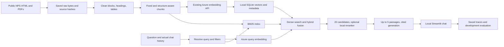

# ParkGuide local proof of concept plan

Prepared October 9, 2026 and approved for implementation by Robin's "go for it". This plan is based on the course assignment and ParkGuide proposal. Submission, remote Git, and deployment remain outside the authorized scope. Robin subsequently confirmed instructor topic approval and explicitly chose a documented placeholder contact email.

Robin simplified the generator on October 10, 2026: all hosted calls now use the existing embedding Azure resource, with Luna for generation and claim review. This explicit user decision supersedes the proposal's original GPT-4 generator; historical results retain their actual model and rates.

Your three areas are the right structure: prepare the corpus/database, build retrieval and chat, then evaluate and iterate. Evaluation design starts during corpus preparation, because source-grounded reference answers must exist before chatbot outputs can influence them. Most complexity comes from preserving evidence and demonstrating improvements, rather than from hosting or application architecture.

## Scope and source status

Build a local educational chatbot for public visitor information about Yosemite, Yellowstone, and Grand Canyon. Use the proposal's NPS visitor-page scope. The assignment requires at least 150 public pages, including five PDFs and three pages containing tables. Use the proposal's conservative target of **150 HTML documents plus five PDFs**, after extraction and deduplication, so interpretation of the PDF count cannot leave the corpus short. The proposal reports sitemap discovery; that is not proof of a fetched, usable corpus.

The assignment was read from `/Users/robin/Downloads/MSAI633_RAG_Chatbot_Project.docx` (SHA-256 `e2ec5ae628c59d4ca6442a47d50e240a8cf80e6a8aa39956825ddc3c138f1561`). The [ParkGuide proposal](https://cumber-my.sharepoint.com/:w:/r/personal/vtalla32910_ucumberlands_edu/_layouts/15/doc2.aspx?sourcedoc=%7BC1C74E3D-EA29-4308-BB8D-89077D60E7E8%7D&file=ParkGuide_AI_Project_Proposal.docx&action=default&mobileredirect=true) was read in the authenticated browser. Its implementation and GitHub claims have not been independently verified. Requirements below come from those documents; current actions come from Robin's explicit local-PoC request.

## The smallest useful stack

| Part | Choice | Purpose |
| --- | --- | --- |
| Language | Python 3.12 | One language for ingestion, application, and evaluation |
| Database | stdlib SQLite, `data/parkguide.sqlite` | One file for documents, chunks, metadata, vectors, and index manifests |
| Dense retrieval | NumPy exact cosine search | Load normalized vectors and compute a dot product; no vector database server |
| Keyword retrieval | `rank-bm25` | Simple baseline and hybrid search with inspectable scores |
| Embeddings | Existing Azure development endpoint, `text-embedding-3-small` | Cloud generation for both document and query vectors; observed dimension 1,536 |
| Reranking | Local `cross-encoder/ms-marco-MiniLM-L6-v2` | Default on for selected-park chat after a scoped retrieval miss; historical diagnostic default remains off |
| Chat UI | Streamlit | Chat history, clickable citations, refusal messages, and retrieval expanders |
| Answer generation | Azure v1 through the provider SDK, `gpt-6-luna-2026-09-22` | Same resource/key as embeddings; `gpt-6-luna` deployment serves both answers and claim review |
| Extraction | Requests, Beautiful Soup, pdfplumber | Download public HTML/PDFs and preserve headings/tables |
| Evaluation | JSONL, Python/NumPy, pytest contracts | Transparent metrics and recorded experiments without an evaluation framework |

SQLite matches the one-file database idea. MySQL requires a server. At this corpus size, exact NumPy search is a straightforward starting point; benchmark it before adding Chroma or FAISS. This is a design choice, not a measured performance claim. [Python SQLite documentation](https://docs.python.org/3/library/sqlite3.html), [Sentence Transformers semantic search](https://sbert.net/examples/sentence_transformer/applications/semantic-search/README.html).

The original proposal used Chroma and local MiniLM embeddings. This plan deliberately changes those two components to SQLite/NumPy and Robin's existing Azure service. It retains the assignment's dense, BM25, hybrid, reranking, deletion, and migration behavior. See [research](RESEARCH.md) and [Azure verification](AZURE.md).

## 1. Create and populate the database

The crawler uses descriptive `ParkGuideAI-CoursePOC/0.1` with `parkguide-poc@example.com`, an explicit placeholder chosen by Robin. Robin confirmed instructor approval of this travel domain. A genuine contact address is still required for a course-compliant crawl. Parse robots rules in code before fetching. Keep one request per second across the crawler, including retries; stay inside approved NPS paths and skip authentication, personal directories, and external booking sites. Never infer permission from a successful HTTP response.

Save original response bytes, canonical URL, UTC timestamp, and SHA-256 before parsing. Clean navigation, footers, banners, and duplicate content. Keep title, heading path, HTML/PDF type, discoverable effective date, source spans, and crawl time. Redact/drop personal contact details. Preserve table headers and rows; inspect representative HTML/PDF/table extraction manually. Track discovered, fetched, rejected, deduplicated, and usable counts separately. PDF publication dates and current applicability need explicit review.

Store cleaned blocks independently of chunks. Implement fixed 200-token windows with 40-token overlap and a structure-aware alternative using headings, paragraphs, and table rows. Include heading/header text in actual input token counts; split oversized tables with repeated headers and source references. Record distributions and truncation checks. Revisit sizes only through a measured development experiment.

Use deterministic document and chunk IDs. A document ID hashes its canonical URL; a chunk ID hashes document/content revision, cleaner/chunker configuration, source span, and text. Build manifests record model/deployment, dimensions, normalization, tokenizer, corpus/config hashes, and timestamps. Azure's embedding response does not expose an immutable underlying deployment revision; preserve vectors and their hashes rather than claiming full re-embedding determinism.

Generate document embeddings through the tested Azure dev endpoint, cache unchanged text, normalize to unit float32 vectors, validate dimensions/finite values/ID alignment, and import transactionally. Do not mix models or dimensions between corpus and queries. The UI/database stay local; no new cloud compute or remote repository is required.

Implement SQL metadata filters before ranking, document deletion with cascading chunk/vector deletion, and cache invalidation. Demonstrate re-chunking from saved normalized blocks with network disabled: build replacement rows, validate them, activate atomically, delete obsolete derived rows, and prove old IDs and orphaned vectors are absent. Preserve experiment outputs outside the active index.

**Evidence produced:** valid corpus counts/provenance, extraction samples, two chunk distributions, deterministic-ID/filter/delete checks, cloud embedding manifests, and a re-chunk migration readback.

## 2. Build retrieval and the chat application

Implement BM25 and dense search independently. Apply identical filters and stable tie-breaking. Fuse ranks using reciprocal rank fusion, `sum(1 / (60 + rank))`. Fetch 40 per retriever, keep at least 20 unique eligible candidates, and rerank to at most five context passages. If restrictive filters leave fewer than 20, record the shortfall and ask a relevant clarification; never relax filters silently. Record pre/post-rerank scores and latency. The candidate pool's evidence recall limits what reranking can recover. [Retrieve/rerank teaching example](https://sbert.net/examples/sentence_transformer/applications/retrieve_rerank/README.html).

Use a small structured response: answer/action plus claims linked to allowed passage IDs. Resolve citations to stored URLs rather than allowing generated URLs. Check every factual claim's support, validate IDs, enforce the 25-consecutive-word quotation limit, and withhold unsupported claims. Calibrate answer/refusal decisions on dev data; cross-encoder logits are not probabilities.

Use actual history to resolve pronouns, comparisons, and changed park/date constraints, then retrieve fresh evidence for each factual follow-up. Earlier assistant answers are conversational context, never authoritative sources. Streamlit displays history, citations, refusals, and expandable retrieval/reranking traces. Add two coded safeguards: retrieved-content injection handling and source-date/insufficient-evidence handling. For safety-sensitive questions, give a grounded limitation and human referral when warranted.

**Evidence produced:** working local chat, live follow-ups, grounded/refusal cases, readable traces, controlled retrieval/reranking comparisons, and guardrail fixtures.

## 3. Evaluate and iterate

Start source-authored gold questions during workstream 1. Save all 40 source-based drafts before observing any chatbot answers, including diagnostics. The final set has the assignment's categories, a stratified 24-dev/16-test split, and human verification for every answer. Agents may prepare review forms; they cannot certify Robin's review. Questions point to immutable source evidence spans so re-chunking does not invalidate relevance labels.

Compare B0 closed-book, B1 BM25, B2 dense, and B3 selected structure-aware hybrid configuration with reranking optional with frozen generator settings. Keep one-factor development stages for chunking, fusion, reranking, and conversation handling. Measure evidence coverage, Recall@5/@20, MRR, nDCG@10, answer accuracy, claim citation support, both refusal rates, latency, and observed token cost. Report each improvement with paired 95% uncertainty, including inconclusive results.

Run six **real conversations with at least three user turns each**, using the actual prior generated messages and the same service that the UI calls. Test follow-ups, changed parks/dates, comparison, clarification, corpus-absent refusal, and injection/stale/safety handling. Save each turn's query, history, evidence, answer, and score. Continue implementing and re-evaluating until proposed gates pass or a genuine dependency/recorded limit stops progress. See [the full evaluation design](EVALUATION.md).

Only after dev selection and human prerequisites, freeze the whole system and run all four baselines once on the 16 sealed test items in one final batch. Do not tune after inspecting those results. Label at least 15 real failed outputs, with human confirmation, and generate reports from saved results.

## Milestones and review choices

| Milestone | Completion evidence |
| --- | --- |
| Initial setup, complete | Local Git, installed full runtime, independently tested/reused Azure configuration, approved plan |
| Corpus and gold preparation | Usable 150 HTML + 5 PDFs + 3 table pages, provenance, 40 source-authored drafts sealed before outputs; human review pending |
| Baseline | Fixed chunks, Azure vectors, B1/B2 live development results, local chat |
| Measured improvements | Offline re-chunk proof, hybrid/reranker ablations, safeguards, six live dialogues |
| Final assessment | Human gold/failure verification, frozen B0–B3 test batch, paired intervals, reports and demo |

Proposed full-build API budget: **$5 across embeddings, generation, and optional judge calls**, excluding today's tiny authorized connectivity probes. Price metadata must be verified before estimating spend; stop before exceeding the cap, retain partial results, and report incompleteness. Both indices, controlled baseline/ablation calls, and multiple six-conversation runs are complete. Current evidence is linked in [STATUS.md](STATUS.md) and [ITERATIONS.md](ITERATIONS.md). The implementation prompt also limits full dev cycles to ten, with a three-cycle stagnation check. Those limits are guardrails, not completion criteria.

The stack and $5 cap were activated by Robin's implementation authorization; provider access and the application have been exercised. Remaining human prerequisites are source verification of all 40 gold records, confirmation of at least 15 actual failure labels, and development acceptance before the sealed test. The placeholder contact is an explicit local-scope exception, not satisfaction of the course contact requirement.

## Course deliverables and local-phase limits

The course's Friday/Saturday/Sunday sequence can be mapped to the milestones above; no calendar dates are assumed. A shared GitHub repository, protected main, feature PRs, teammate approvals, and cross-stage individual contributions are course deliverables. Robin's current instruction is local Git without a remote, so those remain deferred and must not be reported as satisfied. Solo review expectations and team roles need instructor/team clarification later.

| Report under `reports/` | Evidence it must summarize |
| --- | --- |
| `00_proposal` | Scope, architecture, corpus policy, IDs, stack, evaluation design |
| `01_ingestion` | Counts, robots/rate limits, raw provenance, extraction, dedupe/PII |
| `02_chunking` | Both chunkers, distributions, offline migration and deletion proof |
| `03_golden_set` | Category counts, human verification, frozen split and relevance spans |
| `04_retrieval_reranking` | Dense/BM25/hybrid, candidate ceiling, reranker quality/latency |
| `05_generation` | Prompt/schema, grounding, citations, refusals, conversation checks |
| `06_final_performance` | B0–B3, B0-incorrect subset, uncertainty, cost, 15 reviewed failures |
| `07_ethics` | Coded safeguards, temporal/safety limits, PII and AI-use disclosure |

Also produce reproducible README commands, documented AI assistance, and an 8–10-minute demonstration including refusal and a measured before/after example. Generate reported numbers from real saved runs. Do not use sample numbers, generated human-verification fields, or a passing setup check as evidence that the course project is complete.
