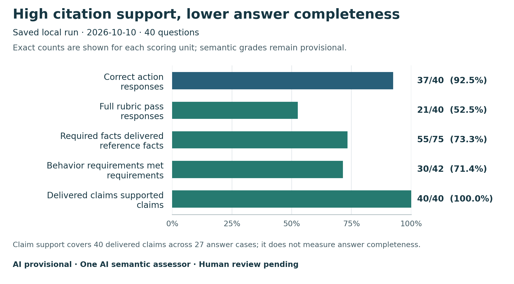
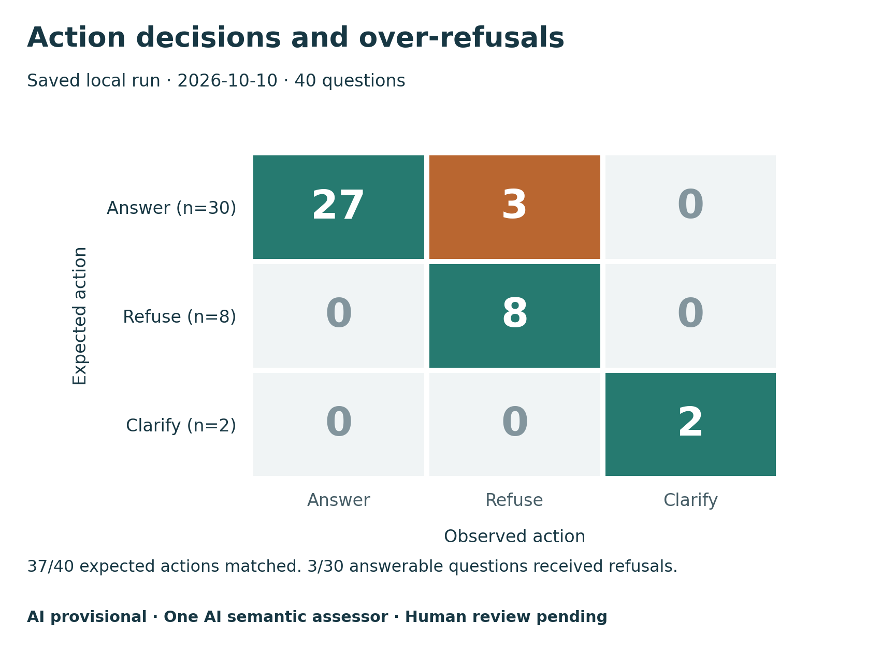
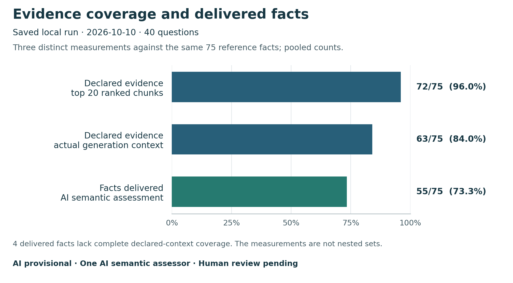

# ParkGuide evaluation report

5 independent configurations produced a source-backed consensus for 40 questions. The saved chatbot run achieved **37/40 correct actions** and **21/40 full rubric passes**. References and semantic grades remain AI provisional; human review is pending.

[All question results](GOLD_MATRIX_RESULTS.md) · [Mechanical metrics](../artifacts/gold-matrix-v1/metrics.json) · [Semantic summary](../artifacts/gold-matrix-v1/semantic-summary.json) · [Evaluation workflow](../docs/EVALUATION_WORKFLOW.md)

Responses were collected on 2026-10-10 at commit `4d3faaf`. Replaying the evaluation recomputes saved results without new chatbot or assessor calls; it does not measure the current deployment.

## Results

| Measurement | Result |
| --- | ---: |
| Fresh calls completed / attempted | 40/40 (0 execution errors) |
| Correct action | 37/40 |
| Action micro precision / recall / F1 | 92.5% / 92.5% / 92.5% |
| Action macro precision / recall / F1 | 90.9% / 96.7% / 93.0% |
| Required facts delivered, AI assessed | 55/75 (73.3%) |
| Behavior requirements satisfied, AI assessed | 30/42 (71.4%) |
| Delivered claims with valid citation identity | 40/40 |
| Delivered claims supported by cited passages, AI assessed | 40/40 (100.0%) |
| Full rubric pass, AI assessed | 21/40 |
| End-to-end latency p50 / p95 | 4.14s / 34.92s |

Semantic figures come from one AI assessor and have not been calibrated against human grades. The 40 delivered claims span 27 answers; a supported claim is not the same unit as a complete answer.



Figure 1. Saved local development outcomes. Bars have different denominators, printed next to each score. Human reference review and calibration of the AI semantic grades remain pending.

| Action | Expected cases | TP / FP / FN | Precision | Recall | F1 |
| --- | ---: | ---: | ---: | ---: | ---: |
| answer | 30 | 27 / 0 / 3 | 100.0% | 90.0% | 94.7% |
| refuse | 8 | 8 / 3 / 0 | 72.7% | 100.0% | 84.2% |
| clarify | 2 | 2 / 0 / 0 | 100.0% | 100.0% | 100.0% |



Figure 2. All three action disagreements are refusals of answerable questions (M024, M027, M036). Matching the requested action does not establish a complete answer or a fully compliant refusal.

| Retrieval | Scorable cases | Hits / retrieved | Hits / known relevant | Micro precision | Micro recall | Micro F1 |
| --- | ---: | ---: | ---: | ---: | ---: | ---: |
| Ranked chunks @5 | 30 | 35/150 | 35/44 | 23.3% | 79.5% | 36.1% |
| Ranked chunks @20 | 30 | 43/600 | 43/44 | 7.2% | 97.7% | 13.4% |

Required-fact evidence coverage is 84.2% at five ranked chunks and 96.7% at 20. Coverage in the actual generation contexts is 84.2% across 30 answerable cases. MRR is 0.794; nDCG@10 is 0.769. Zero-known-qrel items excluded from chunk recall aggregates: none.

The percentages above average each question's evidence fraction equally. The following table pools the same 75 required facts, so its denominator matches delivered-fact coverage:

| Measurement | Pooled facts | Percentage |
| --- | ---: | ---: |
| Declared evidence present in top 20 candidates | 72/75 | 96.0% |
| Declared evidence present in generation contexts | 63/75 | 84.0% |
| Required facts delivered, AI assessed | 55/75 | 73.3% |



Figure 3. These are separate measurements, not a nested funnel. Evidence coverage tests declared source spans; delivered-fact coverage uses an AI semantic judgment. Four facts judged delivered lack complete declared evidence-group coverage in the actual contexts (M008 F1, M010 F1/F2, M034 F1). Declared alternatives are not exhaustive relevance judgments, so this mismatch alone does not establish unsupported content. Subtracting bars does not measure causal losses in retrieval or generation. M036 also includes a numeric-guard refusal.

All figures are available as [PNG and SVG with exact chart data](figures/gold-matrix-v1/README.md). The [figure manifest](figures/gold-matrix-v1/figure-manifest.json) records their input and output hashes. The [research paper](research-paper/ParkGuide_AI_Research_Paper.docx) incorporates these results and limitations.

## Independent labeling matrix

| Labeler | Model / effort | Labels | Proposed facts | Exact quotes checked | Consensus facts represented |
| --- | --- | ---: | ---: | ---: | ---: |
| [codex-sol](../artifacts/gold-matrix-v1/reviewers/codex-sol/labels.raw.json) | gpt-6.1-sol (configured) / high | 40 | 77 | 63 | 75/75 |
| [codex-astra](../artifacts/gold-matrix-v1/reviewers/codex-astra/labels.raw.json) | gpt-6-astra (configured) / xhigh | 40 | 71 | 70 | 73/75 |
| [codex-luna](../artifacts/gold-matrix-v1/reviewers/codex-luna/labels.raw.json) | gpt-6-luna (configured) / high | 40 | 66 | 57 | 70/75 |
| [claude-opus](../artifacts/gold-matrix-v1/reviewers/claude-opus/labels.raw.json) | claude-opus-5-5 / high | 40 | 83 | 81 | 74/75 |
| [claude-sonnet](../artifacts/gold-matrix-v1/reviewers/claude-sonnet/labels.raw.json) | claude-sonnet-5-5 / medium | 40 | 60 | 59 | 71/75 |

40/40 action labels are unanimous. Pairwise action agreement ranges from 1.000–1.000; Fleiss κ is 1.000. Leave-one-out action metrics are in [agreement.json](../artifacts/gold-matrix-v1/agreement.json). These measure agreement, not correctness. Fact representation measures overlap with the derived reference; labelers split and qualify facts differently.

The [consensus dataset](../data/evaluation/gold-matrix-v1/gold-consensus.jsonl) has 75 atomic facts, derived from all five outputs with equal action votes and semantic fact grouping. Facts need three supporters, except a documented source-critical override on M027. Raw labels, votes and fact-detail disagreements on 13 cases are retained. A gpt-6-sol/high adjudicator saw no chatbot outputs; a separate gpt-5.6-sol/high assessor graded responses. A [late evidence supplement](../artifacts/gold-matrix-v1/freeze-incident.json) for M005 is retained separately; scores use the original frozen reference. Codex runtime identities/tokens/costs are unknown; its configurations are recorded. Claude identities and usage come from CLI responses.

## Cases to improve

The group summaries below count each case once within a park and once within its category. Full rubric passes include action, required facts, behaviors, and delivered claim support; they remain AI assessments.

| Group | Value | Cases | Correct action | Full rubric pass, AI assessed |
| --- | --- | ---: | ---: | ---: |
| Park | Grand Canyon | 13 | 13/13 | 8/13 |
| Park | Yellowstone | 13 | 11/13 | 7/13 |
| Park | Yosemite | 14 | 13/14 | 6/14 |
| Category | ambiguous_adversarial | 3 | 3/3 | 1/3 |
| Category | comparative | 4 | 2/4 | 2/4 |
| Category | factual | 15 | 15/15 | 11/15 |
| Category | multi_hop | 6 | 5/6 | 1/6 |
| Category | temporal | 4 | 4/4 | 2/4 |
| Category | unanswerable | 8 | 8/8 | 4/8 |

| Case | Provisional finding |
| --- | --- |
| M004 / PG016 | 1/1 required facts not delivered: The answer recommends offline content but does not say that entire-park content can be downloaded. |
| M005 / PG018 | 2/3 required facts not delivered: Old Faithful Snow Lodge is not mentioned.; The answer says generally open but does not recommend checking current road status. |
| M007 / PG038 | It does not ask for the visit date or time needed to assess whether the place or item is open. |
| M010 / PG027 | It identifies the Summer 2026 schedule but does not say that the saved schedule is subject to change. |
| M011 / PG031 | It directs the visitor to NPS information rather than current airline or booking listings. |
| M012 / PG014 | 3/4 required facts not delivered: The answer does not identify the location as Grand Canyon West. |
| M013 / PG028 | The dated content is stated as current fact rather than explicitly framed as the saved Basic Information snapshot. |
| M014 / PG002 | 1/3 required facts not delivered: It does not explain that food includes every scented item regardless of packaging. |
| M020 / PG035 | It does not refer the visitor to a qualified clinician familiar with the condition and planned hike. |
| M024 / PG019 | expected answer, received refuse |
| M025 / PG001 | 1/4 required facts not delivered: The answer lists permitted windows but does not explicitly say generator use is prohibited at all other times. |
| M026 / PG039 | It does not ask which pass type the visitor means.; It asks for a date or detail, but not the eligibility or entry details that distinguish the listed pass prices. |
| M027 / PG025 | expected answer, received refuse |
| M029 / PG030 | It points only to official NPS information rather than current reservation availability. |
| M031 / PG034 | The generic source-limit response does not explain that the corpus cannot establish tomorrow's Lamar Valley probability. |
| M034 / PG021 | 1/3 required facts not delivered: It does not state that potable trail spigots may be out of service due to season or maintenance.; This may surface water updates, but it does not identify current hiking messages or backcountry water updates as required. |
| M036 / PG022 | expected answer, received refuse |
| M037 / PG017 | 1/4 required facts not delivered: It omits the rule that a fitting trailer does not count toward the motor-vehicle limit.; It says some sites fit only one vehicle but does not advise checking the site's details. |
| M039 / PG015 | 1/2 required facts not delivered: The answer refers to supplied boxes at the three campgrounds but does not state that a large metal box is provided at every campsite. |

These cases form the next targeted regression checks. They were retained in the scores; no answer-quality retries or post-response reference changes were made. Guard events are recorded separately: M036. Uncertain semantic cases: M026, M034.

## Scope and interpretation

All 40 questions come from revised `data/evaluation` candidates. Four cross-park comparisons became within-park comparisons; every request supplies one selected park and empty history. Category lineage: ambiguous_adversarial 3, comparative 4, factual 15, multi_hop 6, temporal 4, unanswerable 8. Of 6 presumed multi-hop cases, 5 use multiple pages; PG016 resolves from one page. Tables, exceptions, dates, source limits and injection are included. Extra scope controls and six dialogue candidates in the [functionality audit](../docs/EVALUATION_FUNCTIONALITY.md) are outside this run.

The packet contains 30 saved NPS documents and a 155-document inventory. Source selection used earlier candidate evidence: this is a development diagnostic with prior exposure, not a held-out benchmark or exhaustive absence search. Human verification remains pending; the original course gold seal is unchanged.

Calls used local `chat.answer` at [commit 4d3faaf](https://github.com/cleveee/parkguide-ai/commit/4d3faaf74f5fdf1ba91fe09193eaaa93f8c4ddb7), hybrid retrieval, no reranker and the pinned Luna snapshot. Settings match the hosted profile; execution and latency are local, without Vercel/UI testing. Responses are fresh; embeddings may use existing cache. The shared Azure ledger increased by $0.081716 estimated cost, not isolated billing. Claude reports $2.266518 separately; Codex costs are unknown.

Precision is TP/(TP+FP), recall is TP/(TP+FN), and F1 is their harmonic mean. Action macro scores average the three classes; micro scores aggregate counts. Failed calls would remain incorrect predictions. [Scikit-learn metric definitions](https://scikit-learn.org/stable/modules/generated/sklearn.metrics.precision_recall_fscore_support.html)

A relevant chunk must fully cover an evidence group for one required fact. @5/@20 use ranked candidates before context pruning; precision divides by actual returned count. Qrels cover declared evidence alternatives, not exhaustive human relevance. Required-fact evidence coverage includes every answerable case with required facts, even when only multiple chunks together support a fact and no single chunk is relevant. The reported coverage is a mean of per-case fractions; the JSON also records pooled fact counts. This differs from older evidence-unit metrics. Citation support divides by delivered claims. Rejected-candidate precision/recall/F1 are unavailable without a labeled candidate universe. The saved-case approach follows the [OpenAI evaluation guide](https://developers.openai.com/api/docs/guides/evals).

## Artifacts and reproduction

[Result manifest](../artifacts/gold-matrix-v1/result-manifest.json) · [Metrics](../artifacts/gold-matrix-v1/metrics.json) · [Per-case metrics](../artifacts/gold-matrix-v1/per-item-metrics.jsonl) · [Agreement](../artifacts/gold-matrix-v1/agreement.json) · [Qrels](../artifacts/gold-matrix-v1/qrels.json) · [Fresh responses](../artifacts/gold-matrix-v1/chatbot/responses.jsonl) · [Semantic assessments](../artifacts/gold-matrix-v1/semantic-assessment.json) · [Frozen consensus adjudication](../artifacts/gold-matrix-v1/adjudication.frozen.json) · [Independent metric review](../artifacts/gold-matrix-v1/metrics-review-final.json) · [Report review](../artifacts/gold-matrix-v1/report-review.json)

Run from the repository with its existing environment. The default verifies frozen input hashes and reproduces all derived files in a temporary directory, checking them against the saved outputs:

```sh
.venv/bin/python scripts/evaluate.py
# Regenerate derived metrics, both reports, and their manifest after scoring edits:
.venv/bin/python scripts/evaluate.py --write
```

These commands make no provider calls and preserve raw labels, responses, assessments, and the consensus. Check mode ignores only generation timestamps when comparing JSON; counts, provenance hashes, and report text must reproduce. New chatbot collection is a separate operation described in the [workflow](../docs/EVALUATION_WORKFLOW.md). The earlier [18-question labeling study](../docs/AI_LABELING_SAMPLE.md) and [retrospective hallucination pilot](hallucination-experiment-20261010/REPORT.md) are separate datasets and are not added to this run's denominators. The linked October 10 independent reviews describe that original snapshot, not later scoring-tool changes.
